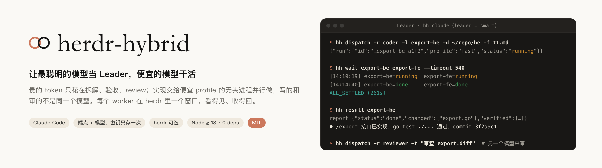
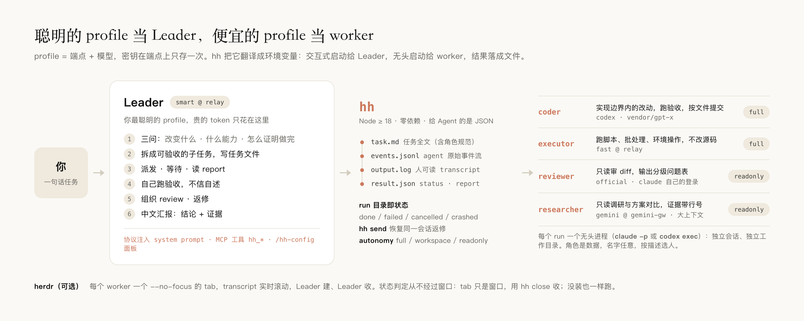
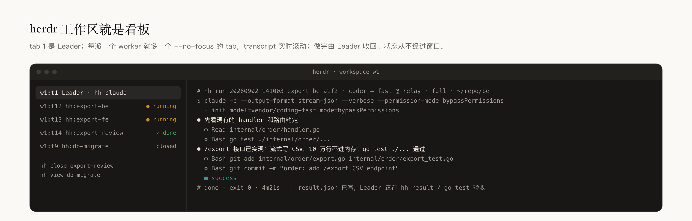
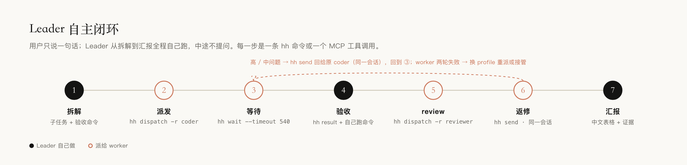
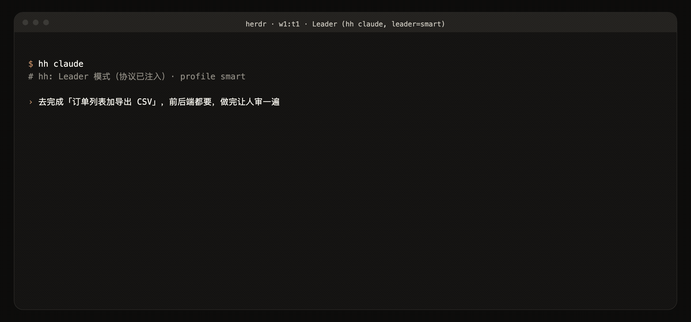

<p align="center">
  <picture>
    <source media="(prefers-color-scheme: dark)" srcset="docs/assets/banner-dark.png">
    
  </picture>
</p>

<p align="center">
  <strong>Let your smartest model lead. Let the cheap ones build.</strong><br>
  Hybrid orchestration for Claude Code and Codex: every subscription, API key and gateway in one config; different models write, review and research each other's work; a Leader that plans and verifies; workers that build in parallel; one herdr tab per worker.
</p>

<p align="center">
  <a href="#why-hybrid">Why hybrid</a> ·
  <a href="#how-it-works">How it works</a> ·
  <a href="#why-herdr">Why herdr</a> ·
  <a href="#get-started">Get started</a> ·
  <a href="#showcase">Showcase</a> ·
  <a href="#what-you-can-say">Prompts</a> ·
  <a href="#config">Config</a> ·
  <a href="README.md">中文</a>
</p>

<br>

## Why hybrid

If you hold several subscriptions, API keys or gateways, this is probably how you use Claude Code today:

| Before | With hh |
| --- | --- |
| **Endpoints scattered across aliases**: `fastcc`, `smartcc`, `geminicc`… each a hand-copied URL, secret and model; nothing can script or orchestrate them | **One `config.json`**: endpoint, secret and model written once; `hh claude fast` to launch, `hh dispatch -p fast` to delegate; old aliases import in one step |
| **Stuck with one vendor at a time**: the model that writes the code also reviews it and researches for it, and never catches its own mistakes | **Cross-model development and review by default**: coder on cheap vendor A, reviewer on vendor B read-only, researcher on long-context vendor C |
| **One thing at a time**: frontend waits for backend, review waits for implementation | **Parallel**: every subtask is its own process, session and directory; the Leader only waits for results |
| **The most expensive model types everything**: planning and typing burn the same tokens | **Expensive tokens only for judgement**: the Leader decomposes, verifies and reports; cheap profiles implement |
| **Trying another model = edit an alias, reopen a terminal, re-explain the context** | **`hh send` resumes the same session**; `-p` re-dispatches the same task to another profile for comparison |

Use official Claude Code or Codex CLIs. In external mode, workers are independent headless processes with their own profile. In native mode, the current CLI manages subagents while hh routes each configured model.

## How it works

<p align="center"><picture>
    <source media="(prefers-color-scheme: dark)" srcset="docs/assets/architecture-dark.png">
    
  </picture></p>

External mode translates profiles into CLI launch configuration and worker events into transcripts and result.json; run state comes from files and process status. Native mode uses hh’s own session router to call model APIs, with a default worker model, optional models, delegation guidance and bounded fallback.

The Leader works from principles, not keywords. At launch it receives the live role roster (who is good at what) and the profile list, then decides for every request what changes, what capability it needs and how completion will be proven. Workers end with a JSON report (files changed, verification commands run, assumptions); the Leader checks data, and follow-ups resume the same session.

Compared with Claude Code's built-in subagents (the Agent tool):

| | Built-in subagents | herdr-hybrid |
| --- | --- | --- |
| Models | Same account and endpoint; opus / sonnet / haiku only | Any endpoint, any model; one profile per role |
| Lifetime | Tied to the current session | Independent processes that outlive the Leader; `hh send` resumes the same session |
| Visibility | Folded into the chat | One herdr tab per worker, or `hh read` |
| Verification | The subagent's own word | JSON report plus the Leader re-running the checks |

With a single endpoint the built-in subagents are usually enough. This project assumes you have **two or more** and want the expensive one to judge while the cheap ones build.

## Why herdr

Headless processes are invisible. [herdr](https://herdr.dev) adds the window and nothing else:

- **One tab per worker** with the transcript scrolling live: which files it reads, which tools it calls, where it is stuck. Created with `--no-focus`, so your cursor stays put.
- **The workspace is the dashboard.** Tab 1 is the Leader; the rest are opened and closed by the Leader (`hh close`).
- **State never goes through the window.** Completion is decided by `result.json` and the process. Tabs are just windows, collected with `hh close`; without herdr everything still runs, just unwatched.
- **One word to get in.** `hh claude herdr` opens the Leader in a new herdr tab, starts the server if needed, and runs in place when you are already inside herdr. If herdr is not installed it asks "install it and open the Leader there?"; Enter runs the official installer and continues. Plain `hh claude` stays in your terminal while workers still get one tab each whenever herdr is running; `hh claude --no-herdr` opens no windows at all, `hh viewer none` turns them off for good.

<p align="center"><picture>
    <source media="(prefers-color-scheme: dark)" srcset="docs/assets/herdr-dark.png">
    
  </picture></p>

## Get started

Three words: a **gateway** is an API URL plus its secret, stored once; a **profile** is gateway + model, and `hh claude <profile>` launches Claude Code with it; a **role** is a job for the Leader to hand out, pointing at a profile. `official` is the built-in profile meaning "whatever `claude` is logged in as".


The only hard requirement is Node ≥ 18. If Claude Code or herdr is missing, `install.sh` offers to install them with the official scripts (herdr is optional; `hh install herdr` any time).

```bash
git clone https://github.com/wangfan1998-github/herdr-hybrid.git && cd herdr-hybrid
./install.sh                                # hh → ~/.local/bin, Leader skill → ~/.claude/skills, offers Claude Code / herdr, runs hh init
```

**First configuration.** When `hh init` runs in a terminal and finds no endpoint it drops into `hh setup` (also runnable any time): a short Q&A adds one endpoint, asks whether it leads or works, and sends a real `pong` to check connectivity. Run it once per endpoint; running it again with the same URL reuses the endpoint and only adds a model. The non-interactive equivalent:

```bash
hh gateways set relay --url https://relay.example.com --auth token --secret sk-xxx   # endpoint + secret (or env:VAR)
hh profiles set fast  --gateway relay --model vendor/coding-fast                     # endpoint + model = profile
hh profiles set smart --gateway relay --model vendor/reasoning-max
```

**Already keeping keys in shell aliases?** `hh init` imports them: lines like `alias fastcc="ANTHROPIC_BASE_URL=… ANTHROPIC_AUTH_TOKEN=… claude"` in `~/.shell_aliases`, `~/.zshrc` or `~/.bashrc` become profile `fast`, and aliases sharing a URL and secret collapse into one gateway.

Note: hh's interactive prompts, help text and Leader reports are in Chinese for now; every command also returns JSON when stdout is not a terminal.

Then assign, verify, launch:

```bash
hh roles set coder --profile fast           # cheap and fast does the work
hh roles set reviewer --profile official    # the writer is never the reviewer
hh leader smart                             # your smartest profile leads
hh doctor --net                             # real round trip for every profile a role uses
hh claude                                   # start the Leader in this terminal (one herdr tab per worker while herdr is running)
hh claude herdr                             # open the Leader itself in a new herdr tab; hh claude --no-herdr = no windows at all
```

> **Default permissions**: `hh claude` passes `--dangerously-skip-permissions`, and the `full` autonomy of coder / executor maps to `--permission-mode bypassPermissions`. Workers get your full local rights; dispatch only into directories you trust, and tighten via `claude.interactiveArgs` and each role's `autonomy` (`workspace` / `readonly`).

<p align="center"><picture>
    <source media="(prefers-color-scheme: dark)" srcset="docs/assets/loop-dark.png">
    
  </picture></p>

## Showcase

One full loop as seen from the Leader tab (decompose → two coders in parallel → wait → re-run verification → review by a different model → follow-up in the same session → report):

<p align="center"></p>

Real output; gateway and model names replaced with placeholders.

```text
$ hh dispatch -r coder -l e2e -d ~/work -t "Create ok.txt containing: hybrid works. Then reply: done"
run      20260902-172446-e2e-9e5c
role     coder → fast@relay(vendor/coding-fast) · full
cwd      ~/work
task     ~/.local/state/hh/runs/20260902-172446-e2e-9e5c/task.md
launch   herdr tab w1:tT
status   ● running

$ hh wait 20260902-172446-e2e-9e5c
[17:24:48] 20260902-172446-e2e-9e5c=running
[17:25:18] 20260902-172446-e2e-9e5c=done
ALL_SETTLED (30s)
(followed by a status table of the runs, omitted)
```

The worker's structured report (Chinese in the real output):

```json
{ "status": "done", "summary": "created ok.txt with 'hybrid works', verified",
  "changed": ["ok.txt"], "commits": [],
  "verified": [{ "cmd": "cat ok.txt", "ok": true }],
  "assumptions": ["not a git repo, nothing committed"], "blockers": [] }
```

What the herdr tab shows at the same moment:

```text
$ claude -p --output-format stream-json --verbose --permission-mode bypassPermissions --model vendor/coding-fast
  · init model=vendor/coding-fast mode=bypassPermissions
  ⚙ Write ok.txt
⏺ done
  ■ success
# done · exit 0 · 30s
```

A follow-up resumes the same session:

```text
$ hh send e2e -t "append a second line: line two"
run      20260902-172530-e2e-r1-11c4
launch   herdr tab w1:tU   parent 20260902-172446-e2e-9e5c (resumed)
```

Inside an agent's shell every command above returns JSON.

Granularity: even a trivial task takes a worker thirty seconds to two minutes (headless startup plus at least two turns). Dispatch subtasks of a few minutes to half an hour; a few-line change is faster done by the Leader itself, which the protocol also says.

## What you can say

Talk to the Leader in plain language; it decides the type of work and who gets it:

```text
Add CSV export to the order list, frontend and backend, then have it reviewed
Research what ~/code/foo does; give me the entry points and core flow with file:line
Run every go test under be/ and summarise failures per package
Review /tmp/export.diff, focus on the API contract and error handling
Who is working right now? Nudge anyone stuck
Switch the reviewer to smart; add a tester role on fast that only runs tests
```

## Config

`~/.config/hh/config.json` (mode 600):

```json
{
  "leader": "smart",
  "gateways": { "relay": { "url": "https://relay.example.com", "auth": "token", "secret": "env:RELAY_KEY" } },
  "profiles": {
    "official": { "gateway": null },
    "fast":     { "gateway": "relay", "model": "vendor/coding-fast" },
    "smart":    { "gateway": "relay", "model": "vendor/reasoning-max" }
  },
  "roles": {
    "coder":    { "profile": "fast",     "autonomy": "full",     "desc": "implement within a clear boundary, run verification, commit per file" },
    "reviewer": { "profile": "official", "autonomy": "readonly", "desc": "read-only diff review with severity-ranked findings" }
  }
}
```

A profile is gateway + model; the key lives on the gateway and is stored once. Roles are data: any name, `desc` tells the Leader what it is for, `autonomy` maps to `--permission-mode`. Secrets live only in this file (or `env:VAR`) and are masked in every output.

### /hh-config: edit the config visually inside the Leader

`hh claude` attaches `mod/` (a Claude Code function-hooks plugin) when it starts a Leader, so typing `/hh-config` in that session opens a pane with three tabs — profiles / gateways / roles — where every row can be edited or removed, plus a "+ new" button.

- **Anything with a fixed set of values is a dropdown, not a text field**: `agent` (claude / codex), `auth` (token / apikey) and `autonomy` (full / workspace / readonly) are fixed enums, while `gateway` and `profile` read their options live from `hh gateways/profiles --json` — so whatever you pick exists, and "the gateway this profile references does not exist" stops being possible. `url` / `secret` / `model` / `desc` and the name stay text inputs.
- The pane only draws. **Every read and write shells out to `hh … --json`**, so validation, reference protection (removing a gateway a profile still uses is refused) and the 0600 write path are exactly the same as on the command line — there is no second implementation to keep in sync.
- **Secrets are never echoed**: the list shows `plat***cQ`, and the secret field starts empty, where empty means "leave unchanged". Type a new value only to rotate it; `env:VAR_NAME` works too.
- Profiles running `codex` are tagged `[codex]` in the list; the default `claude` is left untagged.
- `/hh-config` toggles: run it again to close, or press Esc, or hit the `✕` button.
- The pane docks on the right by default. `hh pane bottom` moves it above the prompt, `hh pane right` moves it back. Placement itself is decided by the terminal layout and cannot be set by a plugin, so the switch really toggles `CLAUDE_CODE_NO_FLICKER`: the bottom seat needs it off, which can make the screen flicker on redraw — hence right stays the default.
- Attached in Leader mode only, and only for agents that support plugins (`agent.capabilities.mod`) — `hh claude <profile>` means "just use this model" and stays untouched.
- Nothing is installed into `~/.claude`: `--plugin-dir` lasts for that session, and uninstalling hh takes it away.

**Prerequisite**: Claude Code needs function hooks enabled, via `~/.claude/settings.json`:

```json
"CLAUDE_CODE_ENABLE_FUNCTION_HOOKS": "1"
```

Without it `/hh-config` simply does not appear; nothing else is affected. `hh doctor` reports this under `leader.mod`.

> Function hooks are an **early access** Claude Code surface (its own type file says it "may change between releases without notice"). After upgrading Claude Code, regenerate types with `/plugin-types` inside `mod/` and re-run `claude plugin test mod/`.
>
> The pane's logic is covered by `mod/tests/pane.test.tsx` (rendering, secret masking, save arguments, error surfacing, command registration). How it looks in the interactive TUI is worth confirming once yourself with `hh claude`.

## More

<details>
<summary>Command cheat sheet</summary>

```bash
hh init [--force] [--no-setup]    write config; import claude-launch aliases; drop into hh setup when no endpoint exists
hh setup                          Q&A: add an endpoint + profile, assign it, send a pong
hh install claude|herdr [--yes]   install a missing dependency with its official script
hh doctor [--net] [--all]         health check; --net sends a real pong per profile used by a role
hh claude [herdr] [--leader] [profile]   no profile = Leader mode; with profile = launch in this terminal; herdr = open in a new herdr tab
    --no-herdr                    no windows at all, workers included
hh viewer [auto|herdr|none]       whether workers get herdr windows; herdr = hh claude opens in herdr too
hh pane [right|bottom]            dock the /hh-config pane on the right (default) or above the prompt
hh env <profile> [--reveal]       the environment that will be injected
hh dispatch -r ROLE [-p PROFILE] [-m MODEL] [-a full|workspace|readonly] [-l LABEL] [-d CWD] (-f FILE | -t "TASK")
hh wait ID... [--timeout 540]  ·  hh status [--all]  ·  hh read ID [-n 60]  ·  hh result ID  ·  hh task ID
hh send ID (-t "TEXT" | -f FILE)  ·  hh cancel ID  ·  hh close ID  ·  hh view ID  ·  hh log  ·  hh clean
hh gateways [set NAME --url U --auth token|apikey --secret S | rm NAME]
hh profiles [show|set|rm|test NAME | aliases | import-aliases]
hh roles [set ROLE --profile P [--autonomy A] [--desc "…"] | rm ROLE]  ·  hh leader [PROFILE]
hh install-mcp  ·  hh mcp
```
</details>

<details>
<summary>Migrating from shell aliases</summary>

`hh init` imports them automatically; `hh profiles import-aliases [--dry-run] [FILE…]` re-imports any time (existing entries are kept). Only single-line `alias NAME=…` entries containing `ANTHROPIC_BASE_URL=` and `claude` are recognised; multi-line aliases and functions need a manual `hh profiles set`.

| Before | Now |
| --- | --- |
| `fastcc` | `hh claude fast`; `eval "$(hh profiles aliases)"` regenerates the same alias names |
| `ANTHROPIC_MODEL` in the alias | the profile's `model` |
| other `K=V` in the alias | the profile's `env` (values equal to `commonEnv` are dropped) |
| several aliases with the same URL and secret | one gateway, several profiles |
</details>

<details>
<summary>Security</summary>

- `hh claude` passes `--dangerously-skip-permissions` by default (`claude.interactiveArgs`); `full` autonomy hands a worker your local rights, so dispatch only into directories you trust and keep review / research roles `readonly`.
- The gateway URL, secret and model variables are recomputed per worker profile; the Leader's own never leak into an `official` worker. Other environment variables are inherited as usual.
- Concurrent workers in one repo: the role templates require `git add <file>` and forbid `git add .`.
</details>

Docs: [config](docs/config.md) · [profiles & report contract](docs/profiles.md) · [observability](docs/observability.md) · [troubleshooting](docs/troubleshooting.md) · [Leader protocol](skill/herdr-leader/SKILL.md) · [example pipeline](examples/feature-pipeline.md)

<p align="center"><sub>Optional viewer built on <a href="https://herdr.dev">herdr</a> · README structure after <a href="https://github.com/0x0funky/agent-sprite-forge">agent-sprite-forge</a>, design guidance from <a href="https://github.com/pbakaus/impeccable">impeccable</a> and <a href="https://github.com/VoltAgent/awesome-design-md">awesome-design-md</a> · MIT</sub></p>

## Dual orchestration modes

`hh run PROFILE --mode external` retains independent Claude Code / Codex workers. Codex can now lead via session-scoped developer instructions. `native` uses the built-in session router and protocol codecs for in-client, cross-provider subagents with a default worker, delegation guidance and request-level fallback. Existing profiles retain their behavior. See [configuration and compatibility limits](docs/orchestration.md). Native mode requires gateway wire formats and a worker policy; it does not turn native children into hh runs.
